# Diagram Reference

Read when choosing a diagram type, quoting labels, checking what the destination's Mermaid supports, or setting up mermaid-cli. The fence and check rules are in `SKILL.md`.

## Does it need a diagram

A diagram earns its place when the reader must see structure that prose spreads over many sentences: ordered steps with branches, who talks to whom, the states of an object, entity relationships. Use prose for a single sequence of steps, and a table for comparisons by attribute.

Text diagrams diff cleanly in review and agents can read them without vision. Keep a hand-drawn or exported image only when Mermaid cannot express the picture, and then commit the source beside it.

## Choose the type

| The reader needs to see | Type | First line |
| -- | -- | -- |
| Steps and decisions in a process | Flowchart | `flowchart LR` or `flowchart TB` |
| Messages between components over time | Sequence | `sequenceDiagram` |
| The states of one object and what moves it between them | State | `stateDiagram-v2` |
| Entities in a data model and their cardinality | ER | `erDiagram` |
| Tasks against a calendar | Gantt | `gantt` |
| Dated events in order | Timeline | `timeline` |
| System context, containers or components at one zoom level | C4 | `C4Context`, `C4Container` |

Do not default to a flowchart. Choosing a different type is right when the question is "what can happen to X" (state) or "who calls whom" (sequence).

## Rules

- **Split large diagrams** into an overview and one diagram per part, and link them in the text.
- **Short labels.** Node labels of 2 to 6 words, edge labels of 1 to 4 words. The detail belongs in the text.
- **One direction.** `LR` for pipelines and timelines, `TB` for hierarchies. Pick one per diagram.
- **Quote special characters.** Wrap labels containing parentheses, colons, quotes or the word `end` in double quotes: `step["Check (dry run)"]`. A bare `end` breaks flowchart parsing. In sequence diagrams `;` ends a statement, so write it as `#59;` (rendered as `;`).
- **Accessibility text.** Timeline and C4 diagrams may not emit `accTitle` and `accDescr` in the SVG; the sentence above the diagram carries the description there.
- **Configure through frontmatter.** Set theme or layout in a `config:` block at the top of the diagram; the `%%{init: ...}%%` directive is deprecated.

````markdown

```mermaid
---
config:
  theme: neutral
---
stateDiagram-v2
    accTitle: Job lifecycle
    accDescr: A job is queued, runs, and ends done or failed; a failed job can be retried.
    [*] --> Queued
    Queued --> Running: worker free
    Running --> Done: exit 0
    Running --> Failed: exit non-zero
    Failed --> Queued: retry
    Done --> [*]
```

````

## Check the destination

Rendering depends on the host and its bundled Mermaid version. Before using newer syntax, `accTitle`, or `config:` frontmatter, find out what the destination renders. A host with an older Mermaid may reject the whole diagram for one unknown line; remove the newest feature first. GitHub shows its version for a fence containing only `info`.

When exporting an SVG or PNG for a destination that cannot render Mermaid, keep the `.mmd` source in the repository and give the image alt text.

## Render with mermaid-cli

The check command in `SKILL.md` also makes the SVG for a page that inlines one; a syntax error writes no SVG.

mermaid-cli drives a Chrome through puppeteer. Without the two variables, puppeteer downloads its own Chrome into `~/.cache/puppeteer` on first run. Point `PUPPETEER_EXECUTABLE_PATH` at an installed Chrome or Chromium (`which google-chrome chromium`) and set `PUPPETEER_SKIP_DOWNLOAD=true` so nothing is downloaded. When Chrome refuses to start because it runs as root or in a container, save `{"args": ["--no-sandbox"]}` as `puppeteer.json` and add `-p puppeteer.json`.

A successful parse shows the diagram is valid, not that the destination renders it or that it matches the system it describes; compare it with the code.
